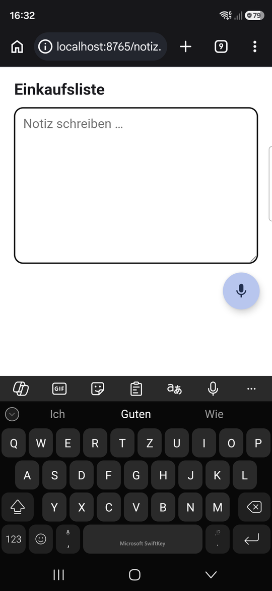
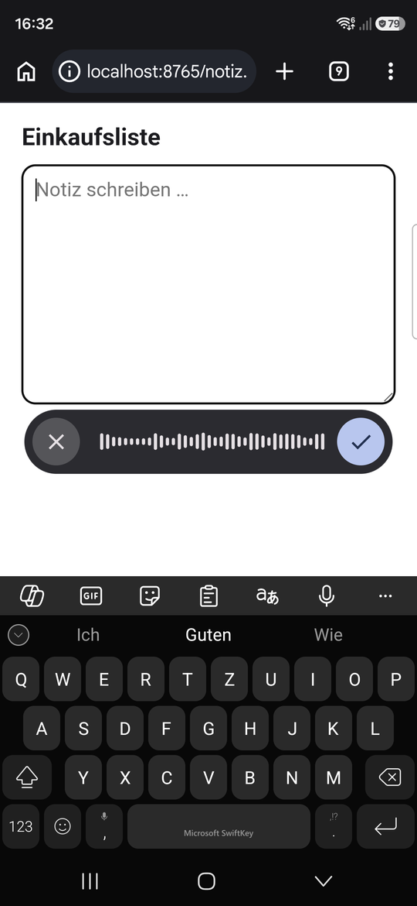
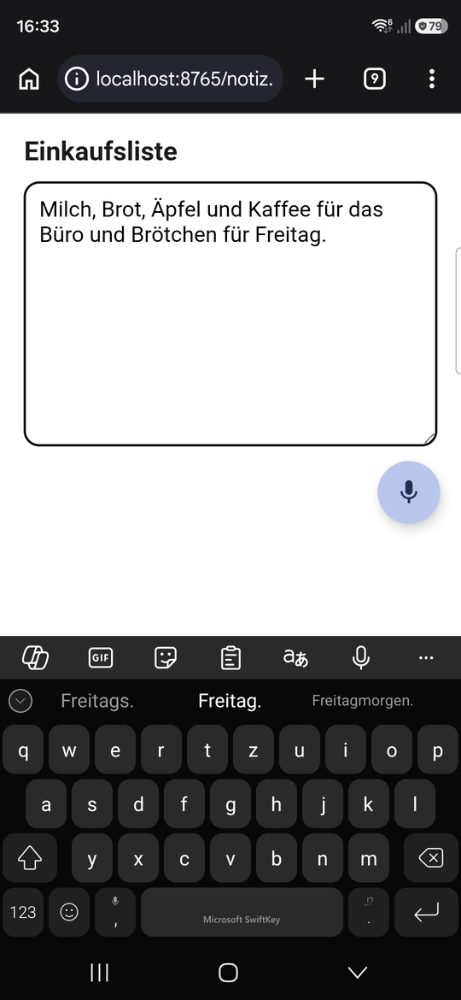
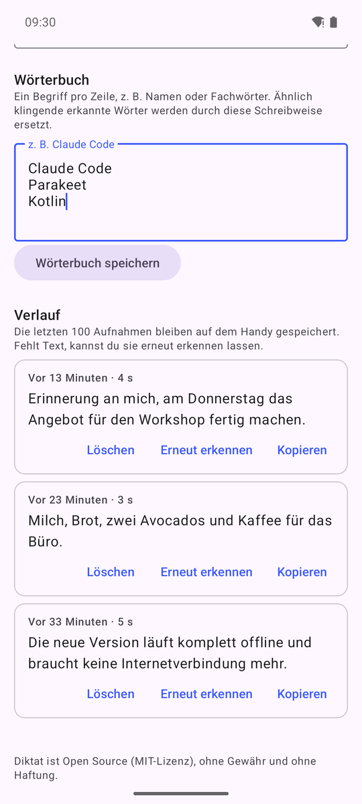

# Diktat – Offline-Spracheingabe für Android

> **Am einfachsten installierst du Diktat mit deinem Coding-Agenten.**
> Öffne Claude Code (oder einen anderen Coding-Agenten) und sag ihm:
> *„Installiere mir die App aus https://github.com/hwalde/diktat-android auf meinem Android-Handy. Folge der AGENTS.md.“*
> Er führt dich Schritt für Schritt durch, vom USB-Debugging bis zum ersten Diktat.

Diktat ist eine deutsche Speech-to-Text-App für Android. Steht der Cursor in einem Textfeld, erscheint ein kleines,
verschiebbares Mikrofon. Antippen, sprechen, ✓, und der Text steht im Feld. Das klappt in jeder App und mit jeder
Tastatur. Die Erkennung läuft **komplett auf dem Handy**, deine Sprache verlässt das Gerät nicht.

<p>
  
  
  
  
</p>

## Was Diktat kann

- **Mikrofon nur bei Bedarf:** Es erscheint, sobald ein Textfeld aktiv ist, und lässt sich an jede Stelle ziehen.
- **Aufnahme mit Waveform:** ✕ bricht ab, ✓ übernimmt. Die Aufnahme läuft weiter, auch wenn du scrollst oder die
  App wechselst. Hat beim Bestätigen kein Textfeld den Fokus, landet der Text im Verlauf und in der Zwischenablage.
- **Funktioniert auch in Apps mit eigenem Editor**, etwa Samsung Notes. Bestehender Inhalt wird nie überschrieben.
- **Wörterbuch:** Namen und Fachbegriffe in deiner Schreibweise, z. B. „Claude Code“ statt „Cloud Code“.
- **Verlauf:** Die letzten 100 Aufnahmen bleiben auf dem Handy. Ist etwas schiefgegangen, gibt es „Erneut erkennen“.
- **Füllwörter** wie „äh“ und „ähm“ werden entfernt.
- **Passwortfelder sind ausgenommen.**
- Sprachmodell: **NVIDIA Parakeet TDT 0.6B v3**. Es ist mehrsprachig (Deutsch, Englisch und 23 weitere europäische
  Sprachen) und erkennt die Sprache selbst.

## Bitte vorher lesen

- **Privates Projekt, ohne Gewähr.** Ich (Herbert Walde) habe Diktat für mich selbst bauen lassen und nutze es
  täglich. Wer es nützlich findet, kann es gern verwenden, forken und für sich anpassen. Die Nutzung erfolgt auf
  eigenes Risiko. Ich übernehme keine Haftung, soweit das gesetzlich zulässig ist, und biete keinen Support an.
  Die rechtlich maßgebliche Fassung steht in der [MIT-Lizenz](LICENSE).
- **Keine Pull Requests.** Diktat ist eine Bedienungshilfe. Sie kann Bildschirminhalte lesen und in fremde Apps
  schreiben. Aus Sicherheitsgründen nehme ich deshalb keinen fremden Code an. Forken ist ausdrücklich erwünscht.
  Siehe [CONTRIBUTING.md](CONTRIBUTING.md).
- **Nicht im Play Store.** Google lässt Apps mit Bedienungshilfe-Dienst nur eingeschränkt zu. Diktat gibt es
  deshalb als APK unter [Releases](https://github.com/hwalde/diktat-android/releases).

## Läuft es auf meinem Handy?

| Voraussetzung | Details |
|---|---|
| Android 13 oder neuer | empfohlen. Android 12 geht auch, nur das Einfügen in Apps mit eigenem Editor ist dort unzuverlässiger. |
| 64-Bit-Prozessor (arm64) | trifft auf praktisch alle Handys ab 2019 zu |
| Arbeitsspeicher | ab ca. 6 GB flüssig, mit 4 GB knapp |
| Speicherplatz | ca. 1,5 GB frei beim Einrichten, danach ca. 700 MB |

Komplett getestet ist Diktat auf einem **Samsung Galaxy S26 Ultra** (Android 16): Chrome, Samsung Notes und
weitere Apps. Im Android-Emulator unter **Android 12, 13 und 16** sind Einrichtung, Mikrofon-Symbol und
Spracherkennung geprüft. Das Einfügen nach einem Diktat ließ sich dort nicht prüfen, weil der Emulator kein
Mikrofon hat. Auf älteren
Mittelklasse-Handys dauert die Erkennung spürbar länger. Bei Xiaomi, Huawei und Oppo kann die Akku-Optimierung
den Dienst beenden. Abhilfe steht in der [AGENTS.md](AGENTS.md#wenn-etwas-nicht-klappt).

## Installation

**Mit Coding-Agent:** siehe oben. Die ausführliche Anleitung für den Agenten steht in [AGENTS.md](AGENTS.md).

**Von Hand, direkt am Handy:**

1. Die Datei `diktat.apk` aus dem [neuesten Release](https://github.com/hwalde/diktat-android/releases/latest)
   am Handy herunterladen und öffnen. Android fragt, ob der Browser Apps installieren darf: erlauben.
2. Diktat öffnen und **Mikrofon erlauben**.
3. **Sprachmodell laden** (670 MB, einmalig, am besten im WLAN).
4. **Bedienungshilfe einschalten:** In der App auf „Bedienungshilfe öffnen“ tippen, dann Installierte Apps →
   Diktat → einschalten. Ist der Schalter gesperrt: Einstellungen → Apps → Diktat → ⋮ (oben rechts) →
   „Eingeschränkte Einstellungen zulassen“, dann noch einmal.
5. Im Feld „Ausprobieren“ testen.

## Datenschutz

- Die Spracherkennung läuft vollständig auf dem Gerät. Internet braucht die App nur einmal, für den Download des
  Sprachmodells von Hugging Face.
- Aufnahmen, Texte und Wörterbuch liegen nur im privaten Speicher der App auf deinem Handy. Es gibt keine
  Analyse-Tools, keine Werbung und keinen Server.
- Als Bedienungshilfe darf Diktat sehen, welches Textfeld aktiv ist, und dort Text einfügen. Mehr nutzt es nicht.
  Das lässt sich im Code nachprüfen: [`DiktatAccessibilityService.kt`](app/src/main/java/de/herbertwalde/diktat/DiktatAccessibilityService.kt).

## Wie Diktat entstanden ist

Auf dem Desktop nutze ich [Handy](https://handy.computer), eine Open-Source-Diktier-App mit lokalem Modell. Auf
dem Handy hatte ich bisher eine kommerzielle App, die bei mir nicht zuverlässig lief. Handy gibt es aber nicht für
Android. Also habe ich Claude gebeten, mir eine Android-Version zu bauen, zumindest für den Funktionsumfang, den
ich brauche.

**Den Code hat Claude Opus 5.5 (Anthropic) mit Claude Code geschrieben**, an einem Tag, dem 12. Oktober 2026.
Ich habe die Anforderungen gestellt und die Ergebnisse abgenommen. Claude hat die App auch selbst auf meinem Handy
getestet: Der Mac hat über seine Sprachausgabe Sätze ins Handy-Mikrofon gesprochen, Claude hat per USB getippt
und die Screenshots ausgewertet. Ein zweiter, unabhängiger KI-Prüfer hat jede Änderung gegengeprüft.

Ich bin KI-Trainer ([entwickler-training.de](https://entwickler-training.de)). Für mich ist es kein Makel,
sondern der Punkt, dass hier eine KI den Code geschrieben hat.

## Herkunft und Lizenzen

Diktat steht unter der **MIT-Lizenz**. Übernommen bzw. eingebunden sind:

| Bestandteil | Lizenz |
|---|---|
| Wörterbuch- und Füllwort-Logik aus [Handy](https://github.com/cjpais/Handy) (CJ Pais), nach Kotlin portiert | MIT |
| [sherpa-onnx](https://github.com/k2-fsa/sherpa-onnx), Spracherkennungs-Laufzeit | Apache 2.0 |
| [ONNX Runtime](https://github.com/microsoft/onnxruntime) (in sherpa-onnx enthalten) | MIT |
| [Parakeet TDT 0.6B v3](https://huggingface.co/nvidia/parakeet-tdt-0.6b-v3) von NVIDIA, wird beim Einrichten heruntergeladen | CC BY 4.0 |
| AndroidX, Material Components, Kotlin Coroutines | Apache 2.0 |

Details, Lizenztexte und die Abweichungen von Handy stehen in [THIRD_PARTY_NOTICES.md](THIRD_PARTY_NOTICES.md).

## Für Entwickler

Native Kotlin-App, kein Port der Tauri-Desktop-App. Ein schwebendes Symbol über fremden Apps und das Einfügen in
deren Textfelder geht auf Android nur über einen **AccessibilityService**.

| Datei | Aufgabe |
|---|---|
| `DiktatAccessibilityService` | Textfeld erkennen, Aufnahme steuern, Text einfügen |
| `OverlayController`, `WaveformView` | Mikrofon und Aufnahmeleiste (`TYPE_ACCESSIBILITY_OVERLAY`, nie fokussierbar, damit die Tastatur offen bleibt) |
| `SpeechEngine` | Parakeet über sherpa-onnx. Lange Aufnahmen werden an leisen Stellen in Stücke von max. 25 s geteilt. |
| `TextPostProcessor` | Wörterbuch und Füllwörter (Port aus Handy) |
| `HistoryStore` | Verlauf mit Audiodateien, max. 100 Einträge |
| `ModelManager` | Modell-Download mit SHA-256-Prüfung oder Import per USB |

**Textfeld-Erkennung, zwei Fälle:**
1. Das fokussierte Feld meldet sich als bearbeitbar (Browser, Messenger, Formulare).
2. Die Tastatur ist offen, das Feld meldet sich aber nicht als bearbeitbar (eigene Editoren wie Samsung Notes).

**Einfügen, in dieser Reihenfolge:**
1. Über die Eingabeverbindung der Bedienungshilfe (`AccessibilityService.getInputMethod()`, ab Android 13). Das
   schreibt wie eine Tastatur am Cursor und ersetzt nie Inhalt.
2. Nur bei normalen Feldern: `ACTION_SET_TEXT` mit Nachprüfung, weil Chrome verzögert übernimmt.
3. Zwischenablage + `ACTION_PASTE` am selben Feld.
4. Zuletzt nur die Zwischenablage, mit Hinweis.

**Bauen:**

```bash
./gradlew testDebugUnitTest assembleRelease   # JDK 17+, Android SDK Platform 36
adb install -r app/build/outputs/apk/release/app-release.apk
```

Ohne `keystore.properties` im Projektordner signiert Gradle den Release-Build mit dem Debug-Schlüssel. Die APKs
unter Releases sind mit einem eigenen Schlüssel signiert. Wechselst du zwischen beiden, musst du vorher
deinstallieren.
